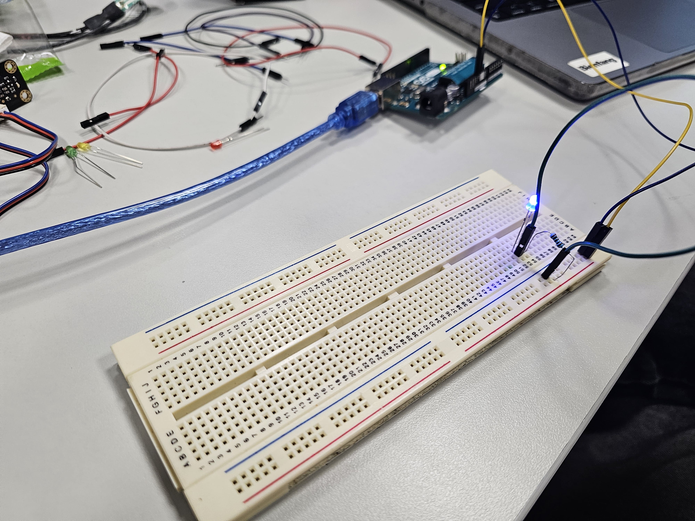

# Week 9 — Arduino Basics

<!-- Replace ## with the week number and Topic Name with the week's focus -->
<!-- You may also refer to each week's slide for the Topic Name -->
<!-- e.g. Week 03 — Arrays & Functions -->

---

### Activities

| Activity | What I Made                   |
| -------- | ----------------------------- |
| `8a`     | <!-- `An always on LED, a blinking LED, and a fading LED.` --> |
| `8b`     | <!-- `An LED that turns off when an ultrasonic sensor detects something too close to itself.` --> |

<!-- Add or remove rows to match the activities for this week. -->

---

### This Week

<!-- A short, informal summary of what you explored across the week's activities. What did you make? What clicked? What didn't?
     A few sentences is all you need — write it like a journal entry, not a report. -->

For this week's activity, we learnt the basics of Arduinos, breadboards, and C++. We learnt the basics of breadboard circuiting, such as which way to put LEDs and where to plug in components into. From this, we built basic circuits controlled by an Arduino controller involving LEDs and sensors, as well as writing code that directly controls electrical hardware. Transitioning from Javascript to C++ was simple as the code languages are very similar, but there were a few quirks involving electrical circuits & Arduinos that weren't apparent to us at first: Arduinos "remember" when an LED has been set to "HIGH" and don't automatically set themselves to "LOW" when the condition they are set to is false, as well as not being familiar with the way electricity flowed. One instance we had an LED wired into one of the digital pins that did not turn on as we had incorrectly wired a resistor, because we had assumed the power came from the 3V/5V pin on the Arduino, but it in actuality it came from the digital pin. Lastly we weren't aware that the top half and bottom half of the breadboard on older models were electrically isolated from one another.

---

### Output



[Activity 8a-02](https://drive.google.com/file/d/1cwq5vp8AFk7_-R9rcIdEcHd61FPOSpfJ/view?usp=drive_link)

<!-- Drop a screenshot, photo, or GIF of something you made this week.
     Save it to a readme-assets/ folder inside this week's folder.
     Made more than one thing worth showing? Add more images. -->

---

<!-- ─────────────────────────────────────────────────────
     GOING FURTHER — if you want to document more, here are some ideas:

     ### 1a — Activity Name
     
     What you tried, what you discovered.

     ### 1b — Activity Name
     
     What you tried, what you discovered.

     ### 🧩 Something I Found Interesting
     A line of code, a technique, a happy accident — paste it here.
     ```js
     // your code here
     ```

     ### ❓ Questions I'm Sitting With
     Anything unresolved, something you want to revisit, or a rabbit hole you fell into.

     ### 🔗 References
     Links to anything that helped or inspired you this week.
     ───────────────────────────────────────────────────── -->
