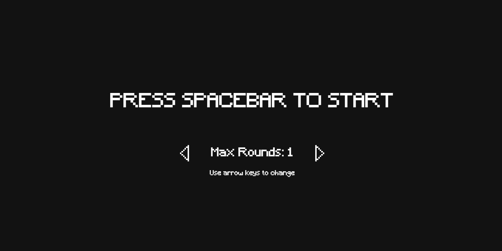
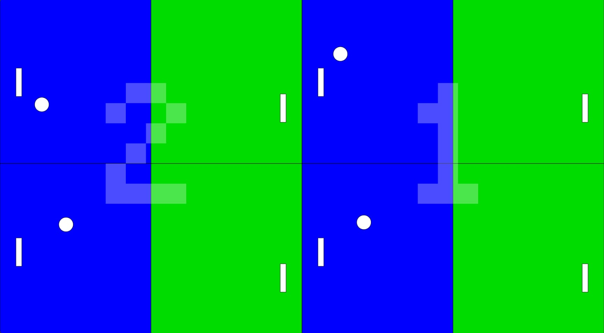

# Mini Project — MULTIVERSE PONG

<!-- Replace "Title" with the name of your project, e.g. "Mini Project — Pong Remix" -->

---

### The Project

We built a Pong game - except that for each subsequent round, players will have to battle in exponentially-multiplying instances of Pong.
<!-- What did you build and what makes it yours? A few sentences is enough.
     What did you change, add, or push beyond the scaffold? -->

---

### Output





<!-- Drop a screenshot or GIF of your finished project.
     Save it to a readme-assets/ folder inside this project folder.
     Got more than one good screenshot? Add them. -->


[Watch Here](https://github.com/furiousskele/dm2008-syiraz-sidin-AY2627-S1/blob/main/dm2008-syiraz-sidin-AY2627-S1/02-mini-project/readme-assets/screen-recording-01.mp4)


[Watch Online](https://drive.google.com/file/d/1S7nviCp3vghS7_zMNq5jd9DyWZiMFs0p/view?usp=sharing)

<!-- Replace the link above with a URL to a screen recording or video of your project.
     ⚠️ Make sure the file or page is set to public before submitting. -->

---

### ✍️ Reflection

We were interested in the Pong assignment as we felt that it was more interesting having two players instead of one like in Flappy Bird. However, we wanted to change it up slightly, and I was inspired by the videogame "5D Chess With Multiverse Time Travel", so we set out to create a Pong game where there were multiple instances of Pong running at any one time, which also allowed us to practice the concept of sub-classes in Javascript. The end result of our game is satisfactory - the game has SFX and a title screen, which are additional polishes on top of the game itself. However, the gameplay might be unbalanced or lacking, but in the context of a coding assignment, I think it accomplishes what it set to do. Additionally, I am proud of how I implemented the screen division system for the game.

As for inputs, the sketch is basic in that context; it responds only to keyboard inputs. The inputs are:

W/S + Up Arrow/Down Arrow - For Left and Right paddles respectively

A/S + Left Arrow/Right Arrow - To adjust round settings in title screen

Spacebar - To begin gameplay/restart round

The biggest challenge was figuring out the screen division system, and I approached it by breaking down the problem into smaller parts, writing down the pattern of screens and then subsequently figuring out the number patterns.

Yes, we would push it further by implementing additional gameplay features such as powerups that the player can pick up by bouncing the ball through them, and extra polishes such as a small frame freeze when the ball hits the paddle.


<!-- 200–300 words on your process. Write freely — this isn't an essay.
     Some prompts to get you started:
     — What did you set out to make, and how did the result compare?
     — What inputs does your sketch respond to, and how did you approach that?
     — What was your biggest challenge, and how did you work through it?
     — What would you push further if you had more time? -->

---

<!-- ─────────────────────────────────────────────────────
     GOING FURTHER — want to document more? Try any of these:

     ### ✨ What I Changed
     A short list of the additions and modifications you made to the scaffold.
     - Changed the paddle to use mouse tracking instead of keyboard
     - Redesigned the visual language with a retro CRT aesthetic

     ### 🔍 Code Structure
     Briefly explain how your files are organised.
     - `sketch.js` — main game loop
     - `Ball.js` — ball class with collision logic
     - `assets/` — sprites and sounds

     ### 🧩 Something I'm Proud Of
     A snippet of code, a design decision, a moment where it clicked.
     ```js
     // your code here
     ```

     ### 🔗 References
     Anything that helped or inspired you — tutorials, artworks, tools.
     ───────────────────────────────────────────────────── -->
