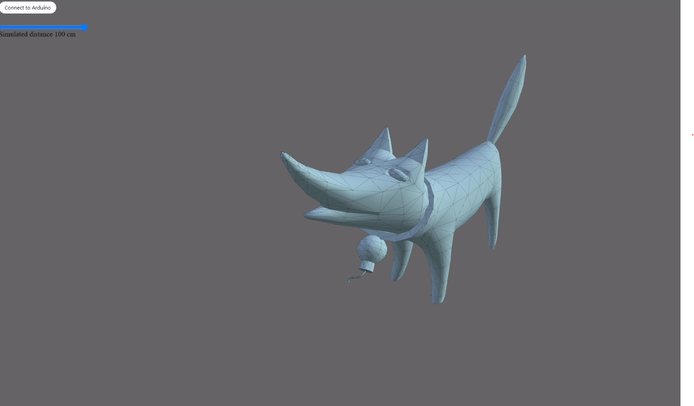

# Sensor Jam — 3D Dog Orbiter

<!-- Replace "Title" with the name of your project, e.g. "Sensor Jam — Theremin Visualiser" -->

---

### The Project

<!-- This is a project where a 3D dog is displayed on the screen. It uses an ultrasonic distanc sensor to control the size of the dog model.. -->

---

### Output



<!-- Drop a screenshot or GIF of your sketch in action.
     Got a photo of your physical setup too? Throw it in.
     Save everything to a readme-assets/ folder inside this project folder. -->

[Watch Online](https://drive.google.com/file/d/1RR_3wYj2JvyUEcn5mapyhiqaxp2Y8Ayt/view?usp=sharing)

<!-- Replace the link above with a URL to a video of your project in action.
     ⚠️ Make sure the file or page is set to public before submitting. -->

---

<!-- ─────────────────────────────────────────────────────
     GOING FURTHER — want to document more? Try any of these:

     ### ✍️ Reflection
     The footage provided of the sketch is a simulation of using the ultrasonic sensor, as we unforunately forgot to take footage of us using the sensor to control the camera.

     ### 🛠️ Hardware
     List the physical components you used.
     - Arduino Uno
     - Ultrasonic sensor (HC-SR04)

     ### 🔍 Sensor Mapping
     How does your sensor data map to visual or sonic output?
     e.g. "Distance (0–400cm) → targetsize (10–400px) using map()"

     ### 🧩 Something I Found Interesting
     A snippet, a technique, a happy accident.
     ```js
     // your code here
     ```

     ### 🔗 References
     Anything that helped — tutorials, datasheets, examples.
     ───────────────────────────────────────────────────── -->
