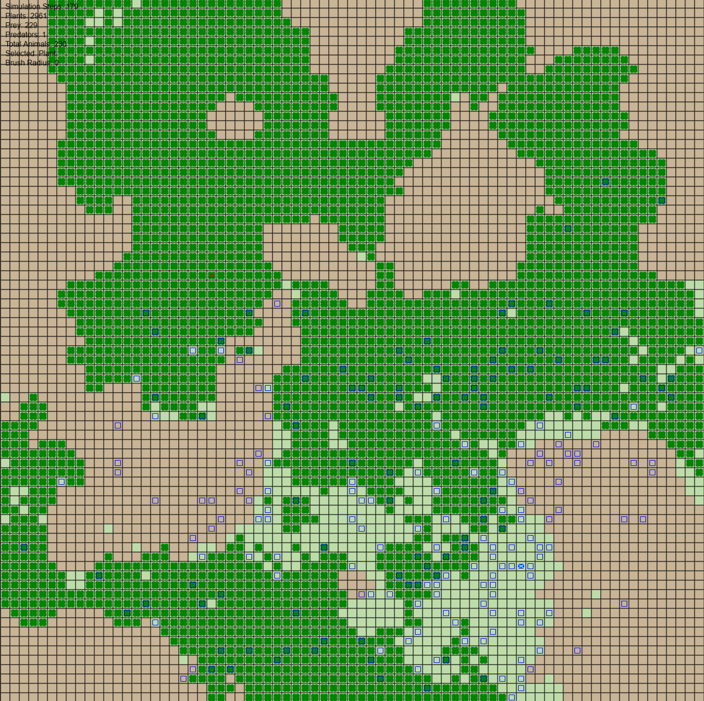

# Final Project — Ecosystem

<!-- Replace "Title" with the name of your project -->

---

### The Project

Our input system uses mouse clicks to randomly generate a population of plants, predators and prey. 
Using the keyboard, the user can toggle between growing plants, prey or predator as well as the size of the population planted. This allows the user to alter the populations of plants, predator and prey to disrupt the balance of the ecosystem, causing it to deplete or regenerate.

---

### Output



<!-- Drop a screenshot or GIF of your project.
     Got more to show? Add more images — let the work speak for itself.
     Save everything to a readme-assets/ folder inside this project folder. -->

[Watch Online](https://drive.google.com/file/d/1q00wjlOG9U4cxICdkfm_BiKHnVDqBxar/view?usp=sharing)

<!-- Replace the link above with a URL to a screen recording or video of your final project.
     ⚠️ Make sure the file or page is set to public before submitting. -->

---

### ✍️ Reflection

Our project uses object oriented programming. The ecosystem is organized around the superclass of Living Thing which contains shared properties such as random movement and boundary checking that is inherited by each class of Predator, Prey and Plant. 

A key system used is a grid based movement system where organisms move between cells using a destination-based random-walk algorithm, and population management systems that regulate feeding, hunting, reproduction and starvation. Each organism has individual attributes, such as hunger levels, movement ranges and lifespan, which determine its behaviour and survival.

---

<!-- ─────────────────────────────────────────────────────
     GOING FURTHER — want to document more? Try any of these:

     ### ✨ Features
     A short list of what your project does.
     - Responds to mouse position and velocity
     - Generates sound based on particle density

     ### 🔍 Code Structure
     How are your files organised?
     - `sketch.js` — main setup and draw loop
     - `Agent.js` — autonomous agent class
     - `assets/` — images and sounds

     ### 🛠️ Hardware (if applicable)
     List any physical components used.
     - Arduino Uno
     - Sensor type and model

     ### 🧩 Something I'm Proud Of
     A snippet, a decision, a moment where it all came together.
     ```js
     // your code here
     ```

     ### 🔗 References
     Tutorials, libraries, artworks, or research that informed your project.
     ───────────────────────────────────────────────────── -->
